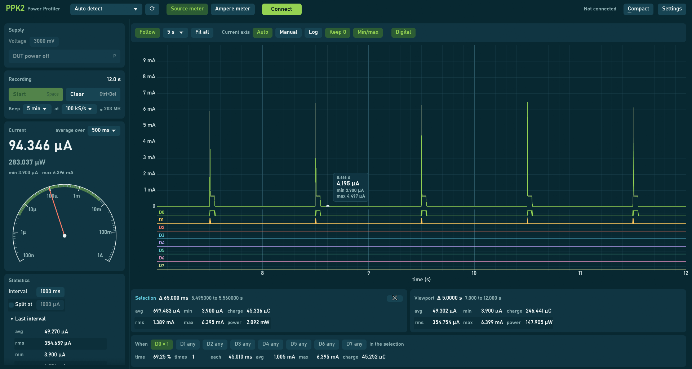
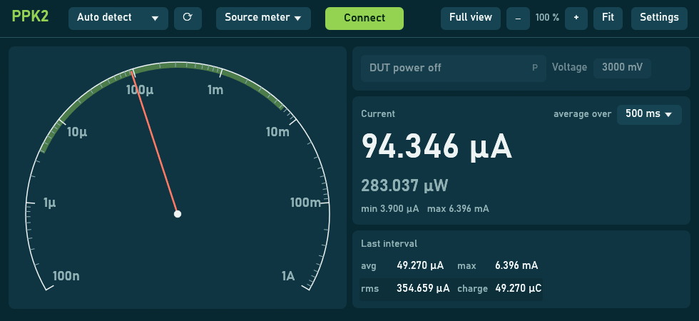
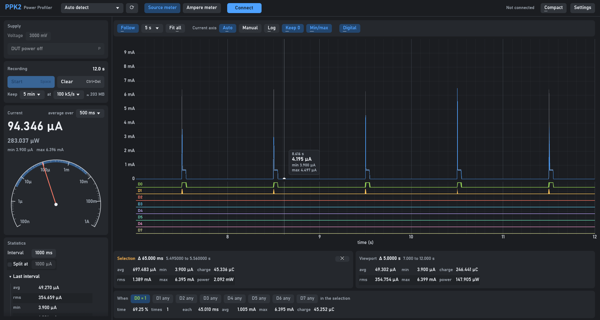
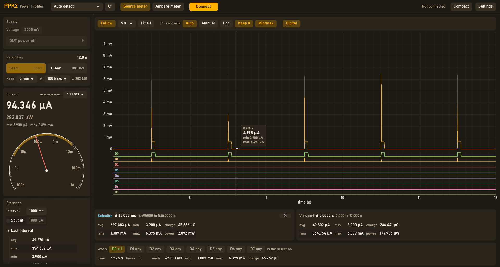
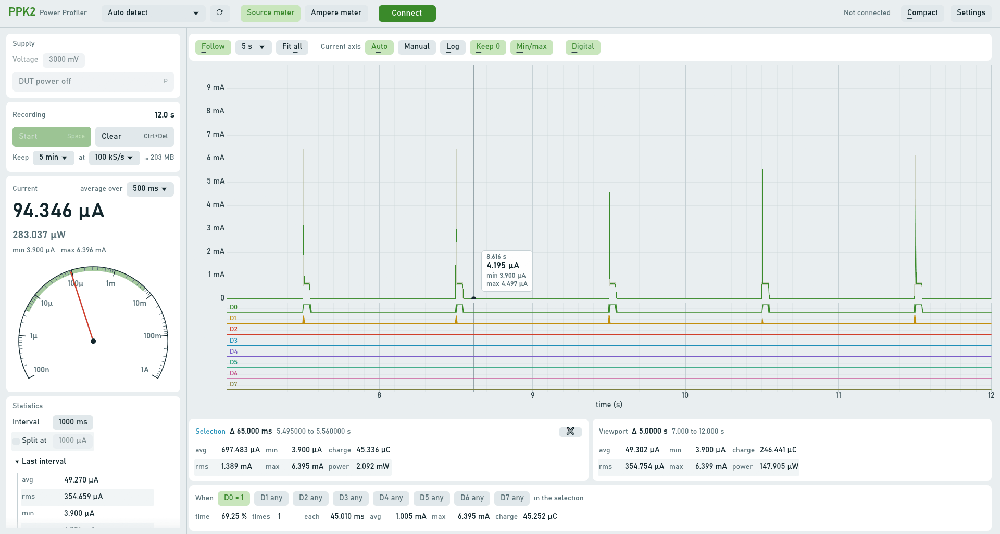
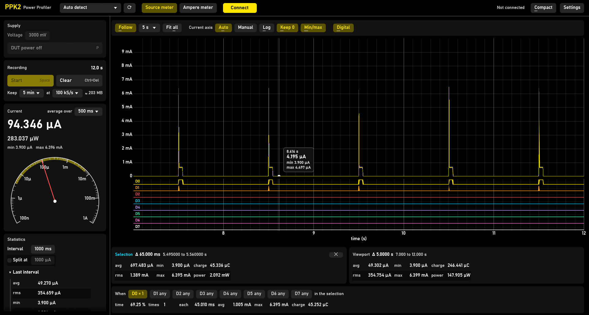

# PPK2-rs

Rust library, CLI and desktop app for working with Nordic Semiconductor's Power Profiler Kit II:

- [Library](#library): connect to the PPK2, configure it and receive measurements
- [CLI](#cli): averaged readings, or statistics of every sample per interval (optionally as JSON)
- [GUI](#gui): a lightweight native alternative to Nordic's Power Profiler, with a live readout, analog meter, plot and statistics

Heavily based on [nrfconnect-ppk](https://github.com/NordicSemiconductor/pc-nrfconnect-ppk) and its derivate [ppk2-api-python](https://github.com/IRNAS/ppk2-api-python).

## Library

Add the crate to your `Cargo.toml`:

```toml
[dependencies]
ppk2 = "0.1"
```

[`examples/cli.rs`](examples/cli.rs) shows how to connect to the PPK2, configure it and receive measurements.

## CLI

The CLI is the `cli` example of this repository. Run it from a checkout, preferably as a release build: in statistics mode it handles every single sample (100 kS/s) and a debug build may not keep up.

```sh
cargo run --release --example cli -- [OPTIONS]
```

### Options

| Option | Default | Description |
|---|---|---|
| `-p`, `--serial-port <PORT>` | auto detect | Serial port of the PPK2, e.g. `COM27` or `/dev/ttyACM0` |
| `-v`, `--voltage <MV>` | `0` | Source voltage in mV, clamped to 800..5000 mV |
| `-e`, `--power <POWER>` | `disabled` | Power the device under test: `enabled` (`e`) or `disabled` (`d`) |
| `-m`, `--mode <MODE>` | `source` | `source` (`s`): source meter, the PPK2 powers the device. `ampere` (`amp`, `a`): ammeter, measure the current of an external supply |
| `-l`, `--log-level <LEVEL>` | `info` | `trace`, `debug`, `info`, `warn` or `error` |
| `-s`, `--sps <SPS>` | `100` | Averaging mode: number of averaged values reported per second |
| `--stats` | | Statistics mode (see below) |
| `-i`, `--interval-ms <MS>` | `1000` | Statistics mode interval |
| `--split-stats <UA>` | | Statistics mode, split every interval at this current into active and sleep parts (implies `--stats`) |
| `--json` | | Statistics mode, write every interval as JSON to stdout (implies `--stats`) |

All options can also be set with an environment variable, e.g. `VOLTAGE=3000`, see `--help`.

The PPK2 always samples at 100 kS/s, the modes only differ in how the samples are reported. Missed samples (detected by the sample counter of the PPK2) are logged as a warning.

### Averaging mode (default)

Averages every chunk of `100000 / sps` samples into one value. The values are logged at debug level, so use `-l debug` to see them:

```sh
cargo run --release --example cli -- -v 3000 -e enabled -l debug
```

This mode only uses the samples taken while logic input D0 is low (an example of matching on the logic port, see `examples/cli.rs`). With nothing connected to D0 that is all of them.

### Statistics mode

Uses every sample and reports once per interval (counted in samples, so USB buffering doesn't skew it):

```sh
cargo run --release --example cli -- -v 3000 -e enabled --stats
```

```text
INFO cli: avg:   371.735 µA  rms:  3171.789 µA  min:     1.463 µA  max: 104842.477 µA  charge:  1115.204 µC  (300000 samples in 2.999 s)
INFO cli: avg_pwr: 1.859 mW (at 5000 mV)
```

- `avg`: average current, determines the battery life.
- `rms`: root mean square current, determines the losses in series resistances (e.g. a battery's internal resistance). Much higher than `avg` for bursty loads.
- `min`/`max`: lowest and highest sample, e.g. for sizing a battery or buffer capacitor.
- `charge`: charge drawn during the interval.
- The duration shows how long the interval actually took: clearly longer than the interval means samples were missed.
- `avg_pwr`: average power (source voltage × average current). Source meter mode only, as the supply voltage is unknown in ammeter mode.

### Active/sleep split

`--split-stats <UA>` splits every interval at the given current into an active part (at or above) and a sleep part:

```sh
cargo run --release --example cli -- -v 3000 -e enabled -i 3000 --split-stats 1000
```

```text
INFO cli: split @ 1000 µA: active   1.02% avg  34810.500 µA ( 94.3% of charge, 3 bursts of 3.400 ms avg) | sleep  98.98% avg  20.480 µA
```

For each part: the share of time and average current, for the active part also its share of the charge, the number of bursts (transitions into active) and their average length. This shows where the charge goes, e.g. whether an increase comes from more or longer active periods or from the sleep current. Choose the split current well above any switching regulator pulses to only count the real activity.

### JSON output

`--json` writes every interval as one JSON object per line (NDJSON) to stdout, all logging goes to stderr:

```sh
cargo run --release --example cli -- -v 5000 -e enabled -i 3000 --split-stats 200 --json > measurement.ndjson
```

JSON output (formatted here for readability)

```json
{
    "ts_ms": 1789456693840,
    "samples": 300000,
    "duration_s": 2.999,
    "avg_ua": 371.735,
    "rms_ua": 3171.789,
    "min_ua": 1.463,
    "max_ua": 104842.477,
    "charge_uc": 1115.204,
    "source_mv": 5000,
    "avg_pwr_uw": 1858.674,
    "split": {
        "threshold_ua": 200,
        "active_pct": 8.17,
        "active_avg_ua": 4455.72,
        "active_charge_pct": 97.96,
        "bursts": 45,
        "burst_ms": 5.449,
        "sleep_pct": 91.83,
        "sleep_avg_ua": 8.242
    }
}
```

| Field | Unit | Description |
|---|---|---|
| `ts_ms` | ms | Unix timestamp at the end of the interval |
| `samples` | | Number of samples in the interval |
| `duration_s` | s | Actual duration of the interval |
| `avg_ua`, `rms_ua`, `min_ua`, `max_ua` | µA | Current statistics |
| `charge_uc` | µC | Charge drawn during the interval |
| `source_mv`, `avg_pwr_uw` | mV, µW | Source voltage and average power (source meter mode only) |
| `split` | | Active/sleep split (with `--split-stats` only): `threshold_ua`, `active_pct`, `active_avg_ua`, `active_charge_pct`, `bursts`, `burst_ms`, `sleep_pct`, `sleep_avg_ua` |

Numbers are rounded to a sensible resolution (3 decimals, 2 for percentages), values that can't be represented in JSON (NaN, infinite) are `null`.

## GUI

[`gui`](gui) (`ppk2-gui`) is a native desktop app built with [egui](https://github.com/emilk/egui): a lightweight and fast alternative to Nordic's Power Profiler. It starts in an instant, handles all 100 kS/s and stays responsive with hours of data.



Run it as a release build, so it keeps up with every sample:

```sh
cargo run --release -p ppk2-gui
```

The screenshots show simulated data: a device sleeping at about 4 µA, waking up once per second for a 3 ms burst of 6 mA followed by 42 ms at 650 µA, with D0 high during the wake-up.

### Connecting and supply

- Auto detects the PPK2 data port (or pick a serial port), as **source meter** (the PPK2 powers the device under test) or **ampere meter** (measure the current of an external supply through VIN and VOUT)
- Set the source voltage (800 to 5000 mV) and switch the **DUT power**, also while recording. Switching the power doesn't interrupt the measurement; changing the voltage briefly does
- Connecting to a PPK2 that is still streaming (e.g. after a crash of another app) just works, and closing the app always leaves the PPK2 in a clean state
- Calibration info shows whether the PPK2 has calibration values

### Live readout and analog meter

- The average current, and the power as source meter, over a selectable window (100 ms to 5 s), updated once per window so it stays readable, plus the minimum and maximum
- An analog meter with a logarithmic scale from 100 nA to 1 A: the damped needle shows what's going on at a glance, with a band from the recent minimum to maximum
- The readout and meter are live whenever connected: the PPK2 measures all the time, Start and Stop only control the recording

### Recording

- **Start** and **Stop** continue the recording, **Clear** starts a new one
- Keeps the samples for 1 minute to 24 hours (5 minutes by default), at 100 kS/s or at a reduced storage rate of 10 kS/s, 1 kS/s or 100 S/s for long runs. A reduced rate stores the average, minimum and maximum of every group of samples: spikes stay visible, and the average, minimum, maximum and charge stay exact
- The memory needed is shown next to the settings, e.g. about 200 MB for 5 minutes at 100 kS/s, 510 MB for 8 hours at 1 kS/s or 150 MB for 24 hours at 100 S/s

### Plot

- The current as an average line plus a min/max band, so short spikes never disappear when zoomed out
- No aliasing jitter: the data is binned per screen pixel on absolute time, so the plot stays steady while following live data or panning through a lot of detail
- Linear or logarithmic current axis, automatically scaled or manually set (type values like `500 nA` or `1.5 mA`), with "Keep 0" to zoom the current axis around zero
- **Follow** the latest samples with a selectable time window (10 ms to 1 min), or **Fit all** to see the whole recording
- The digital inputs D0 to D7 in a plot of their own, sharing the time axis
- Hovering shows the measured value at that time (average, minimum and maximum), following the plot rather than the pointer

| | |
|---|---|
| Scroll | Zoom in time |
| Ctrl + scroll | Zoom the current axis (switches it to manual), around 0 with "Keep 0" (default) or else around the pointer |
| Drag (any button), shift + scroll | Pan in time (stops following the live data) |
| Ctrl + drag | Pan in time and current (switches the current axis to manual, Keep 0 off) |
| Drag the axis labels | Scale that axis |
| Shift + drag | Select a time range |
| Drag an edge of the selection | Move that edge |
| Click, Esc | Clear the selection |
| Double click | Show the whole recording, current axis back to auto |

### Statistics

The same statistics as the CLI statistics mode (average, rms, minimum, maximum, charge, power), for:

- the **selection** and the **viewport**, under the plot
- the **last interval** (10 ms to 10 min), the **interval history** and the **whole recording**, in the side panel. These always use every sample, also at a reduced storage rate
- optionally split at a current into **active and sleep** parts: share of the time, average current, share of the charge, number of bursts and their average duration
- **digital conditions**: the statistics of the selection (or viewport) while the digital inputs are at given levels, e.g. D0 = 1 and D2 = 0. Click a pin to cycle through any, 1 and 0. Shows the share of the time, the number of times, the average duration, and the current and charge during those times

### Compact view



Only the meter, DUT power and voltage, the readout and the last interval, in a small window to keep next to your editor or terminal. It measures by itself while connected. The window is sized to fit: zoom it with − and + (or Ctrl + and Ctrl −), Fit restores the size.

### Keyboard shortcuts

The buttons show their key on the right or underline its letter, and F1 lists them in the app. The single keys work while no text field is being edited.

| | |
|---|---|
| Ctrl + Enter | Connect / disconnect |
| P | DUT power on / off |
| Space | Start / stop recording |
| Ctrl + Del | Clear the recording |
| C | Compact / full view |
| F | Follow the latest samples |
| A | Fit all: show the whole recording |
| U | Current axis automatic / manual |
| L | Logarithmic current axis |
| K | Keep 0 when zooming the current axis |
| M | Show the min/max band |
| D | Show the digital inputs |
| Esc | Close a window or menu, else clear the selection |
| T | Next color theme |
| Ctrl + / Ctrl − / Ctrl + 0 | Zoom in / out / reset |
| F1 | Show the shortcuts |

### Color themes

Settings has five color themes: Teal (above), Graphite, Amber, Light and High contrast. The app remembers the choice, along with the window position and size (on Windows in `%APPDATA%\PPK2\data\app.ron`).

| Graphite | Amber |
|---|---|
|  |  |
| **Light** | **High contrast** |
|  |  |

### Screenshots

The screenshots are made by the app itself from simulated data, without a PPK2:

```sh
PPK2_SCREENSHOT=full.png cargo run -p ppk2-gui
PPK2_SCREENSHOT=compact.png PPK2_COMPACT=1 cargo run -p ppk2-gui
PPK2_SCREENSHOT=light.png PPK2_THEME=Light cargo run -p ppk2-gui
```

## USB permissions (Linux)

On Linux the PPK2 shows up as a serial port (`/dev/ttyACM*`) that normal users can't access by default. Add a udev rule for the PPK2 (USB vendor `1915`, product `c00a`) to give access to the logged in user (`uaccess`) and the `plugdev` group:

```sh
echo 'ATTRS{idVendor}=="1915", ATTRS{idProduct}=="c00a", MODE="660", GROUP="plugdev", TAG+="uaccess"' \
    | sudo tee /etc/udev/rules.d/99-ppk2.rules
sudo udevadm control --reload-rules
sudo udevadm trigger
```

Then disconnect and reconnect the PPK2. Check the result with `ls -l /dev/ttyACM*`.

If your user is not in the `plugdev` group (and you don't rely on `uaccess`), add it with `sudo usermod -aG plugdev $USER` and log in again.

Windows and macOS need no setup: the PPK2 shows up as `COMx` or `/dev/tty.usbmodem*` respectively.
